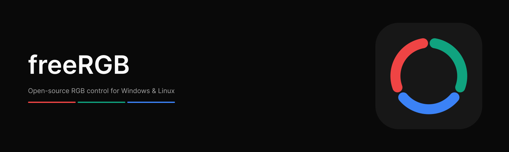
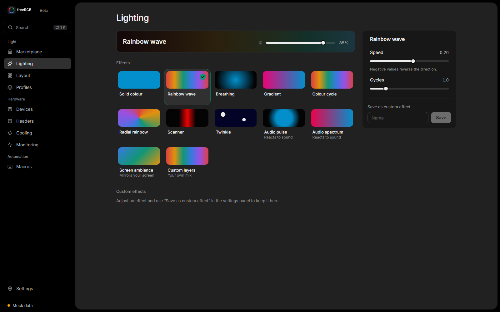
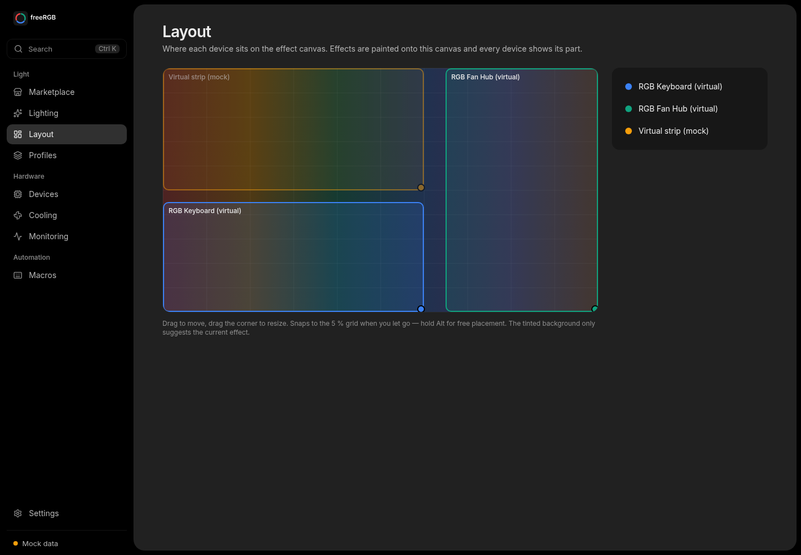
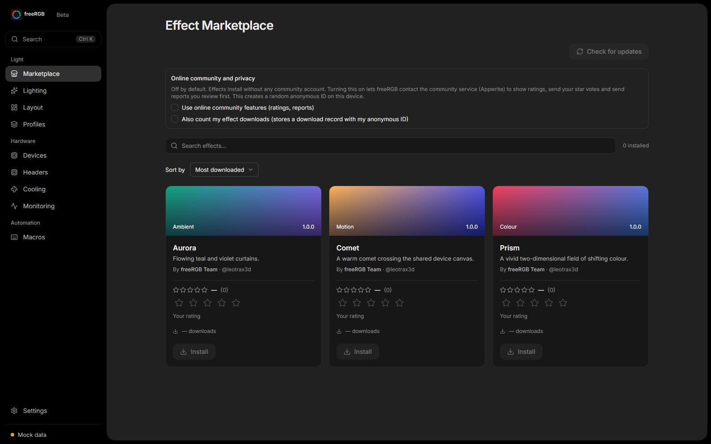
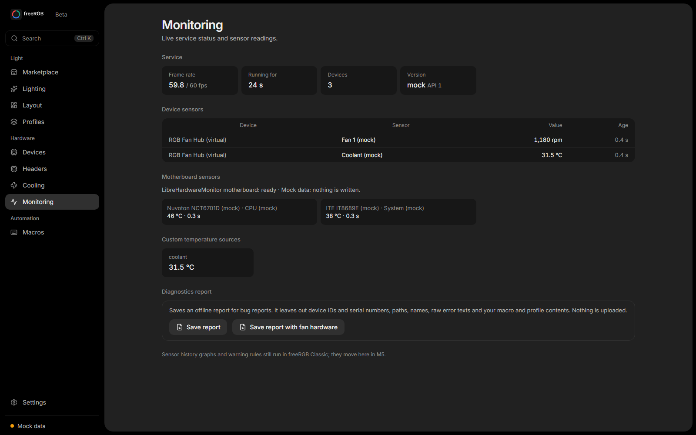
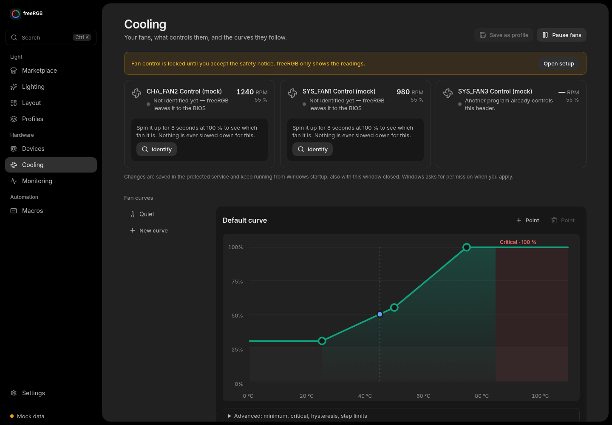
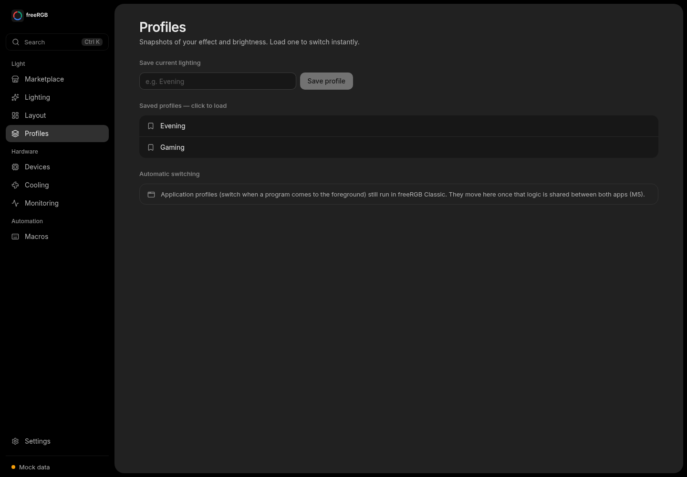
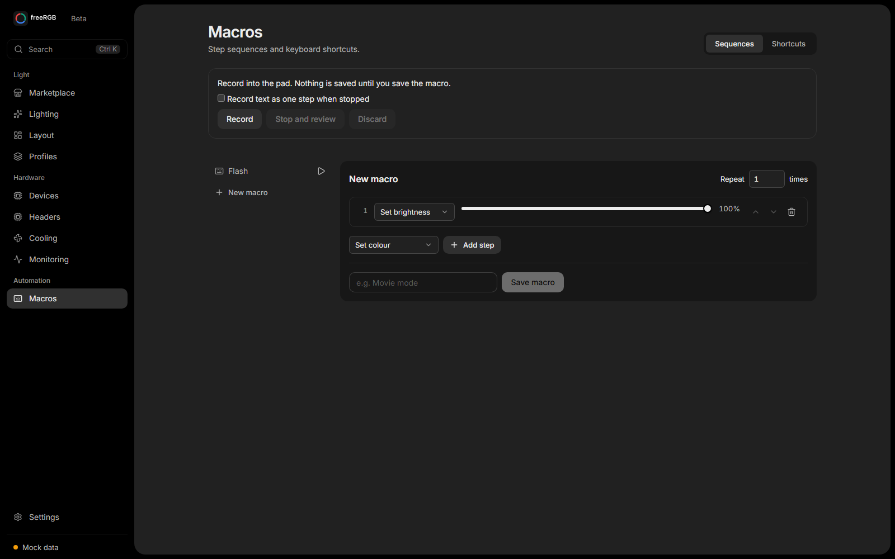
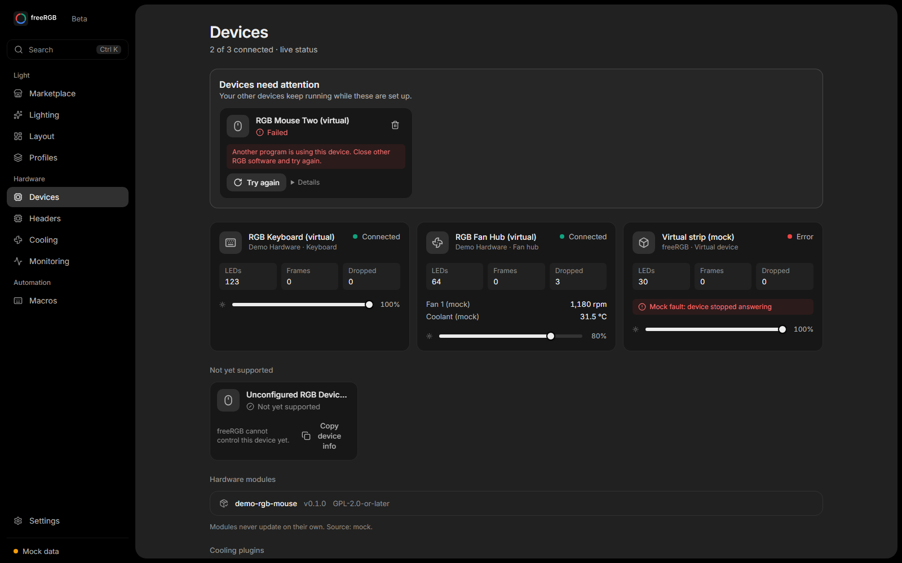
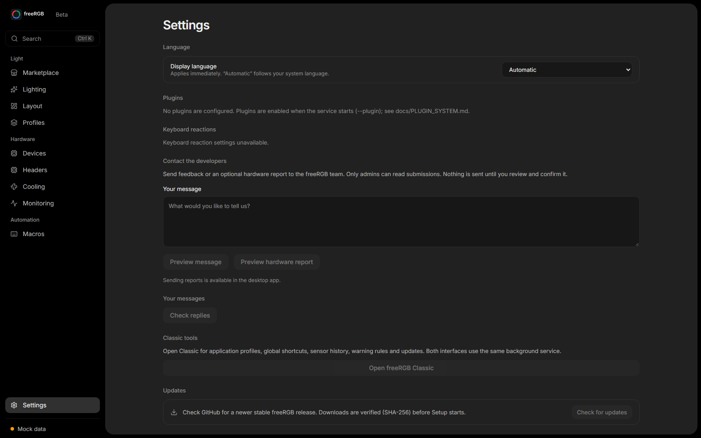

<p align="center">
  
</p>

<p align="center">
  RGB control for Windows and Linux. Built with Rust, Tauri and React.
</p>

<p align="center">
  <a href="https://github.com/leotrax3d/FreeRGB/actions/workflows/ci.yml"></a>
  <a href="docs/RELEASE_NOTES_0.1.0-beta.2.md"></a>
  
  <a href="#license"></a>
</p>

<p align="center">
  <a href="https://github.com/leotrax3d/FreeRGB/releases">Downloads</a> ·
  <a href="https://leotrax3d.github.io/FreeRGB/demo/">Live demo</a> ·
  <a href="#gallery">Gallery</a> ·
  <a href="docs/INSTALL.md">Installation</a> ·
  <a href="https://github.com/leotrax3d/FreeRGB/issues">Issues</a>
</p>

## Features

- **Lighting:** 11 built-in effects, audio-reactive lighting, screen ambience and a custom layer editor.
- **Layout:** arrange devices on a shared effect canvas with per-device brightness.
- **Profiles and macros:** save lighting configurations and automate effects, delays and repeats.
- **Monitoring:** temperature/RPM history, warning rules and diagnostic exports.
- **Effects and integrations:** sandboxed Rust effect packages, device plugins and a local JSON-RPC API.

The background engine keeps running when the GUI closes. Ordinary lighting needs
no cloud account or vendor application. Windows capture and input features do not
yet have full Linux parity.

## Gallery

[](docs/screenshots/lighting.png)

| Layout | Effect marketplace |
| --- | --- |
| [](docs/screenshots/layout.png) | [](docs/screenshots/marketplace.png) |

| Monitoring | Cooling |
| --- | --- |
| [](docs/screenshots/monitoring.png) | [](docs/screenshots/cooling.png) |

<details>
<summary>Profiles, macros, devices and settings</summary>

| Profiles | Macros |
| --- | --- |
| [](docs/screenshots/profiles.png) | [](docs/screenshots/macros.png) |

| Devices | Settings |
| --- | --- |
| [](docs/screenshots/devices.png) | [](docs/screenshots/settings.png) |

</details>

## Installation

Windows installers are listed under [Releases](https://github.com/leotrax3d/FreeRGB/releases).
The current beta.2 candidate is not published yet. Initial beta installers are
unsigned; Windows may display a publisher or SmartScreen warning.
Linux currently requires a source build.

See the [installation guide](docs/INSTALL.md) for dependencies, permissions and
uninstallation, and [updates](docs/UPDATES.md) for checksum verification and upgrades.

### Build from source

Requires [Rust](https://rustup.rs/), Node.js and npm. The tested toolchain is pinned
to Rust 1.99.1; release tooling uses Node 24.19.0. Install the
[platform dependencies](docs/INSTALL.md) first. Windows requires MSVC and Visual Studio C++ Build Tools.

```bash
git clone https://github.com/leotrax3d/FreeRGB.git
cd FreeRGB
cargo build --workspace --release --locked
```

On Windows, build the modern GUI and launch:

```powershell
./scripts/build-desktop.ps1
./target/release/freergb-launcher.exe
```

For Linux Tauri builds, udev rules and the systemd user service, see
[INSTALL.md](docs/INSTALL.md). Use launcher flag `--classic` for the fallback GUI
or `--daemon-only` for background operation.

### Try without hardware

For a browser preview, run in `apps/desktop`:

```bash
npm ci
npm run dev -- --host 127.0.0.1
```

Open **http://127.0.0.1:1420**. The browser preview uses simulated devices.
To test the native app with the real engine and a virtual device, start:

```bash
cargo run --release --locked -p freergb-daemon --bin freergbd -- --no-hardware --no-state --virtual-device
```

Then run `npm run tauri dev` in `apps/desktop`, or
`cargo run --release --locked -p freergb-gui` for Classic.

## Device support

| Device or integration | Status | Scope |
| --- | --- | --- |
| Corsair K70 CORE RGB (`1b1c:1bfd`) | Validated | Per-key RGB; ISO/ANSI mapping |
| Corsair iCUE LINK System Hub (`1b1c:0c3f`) | Experimental, opt-in | Selected RX/LX fan, Titan RX AIO head and LCD-ring lighting; RPM watchdog |
| Motherboard RGB: ASUS Aura USB, Gigabyte RGB Fusion 2 USB, ASRock Polychrome USB | Supported, auto-detected | Per-header ARGB LED counts/names in the GUI; mock-tested only, see [Motherboard RGB](docs/MAINBOARD_RGB.md#hardware-validation) |
| Motherboard fan control (Windows) | Supported with mainboard components | Up to 16 live channels, curves/fixed speed, stop all, resume after restart; watchdog, floors and BIOS return always on |
| Motherboard fan control (Linux) | Supported via kernel hwmon (nct6775, it87, nct6683, f71882fg, …) | All headers the kernel exposes; fixed speed or curves on any hwmon temperature; 40% floor, BIOS return on stop/fault/crash; synthetic tests only, see [Linux fans](docs/COOLING_LINUX_HWMON.md) |
| Other identified devices | Discovery only | Detection does not imply control support |

AIO LCD display content and DDR5 RGB control are not supported.
The LINK hub requires daemon flag `--enable-link-hub`.
See [Devices](docs/DEVICES.md), [Protocols](docs/PROTOCOLS.md) and
[Motherboard support](docs/MAINBOARD_SUPPORT.md) for exact models and limitations.

## Safety

- Close competing RGB controllers before accessing physical devices.
- Cooling requires separate consent and channel identification. Read
  [cooling safety](docs/COOLING_SAFETY.md) before enabling it.
- Unsupported devices have no write adapter. No firmware or flash writes.
- Device-process plugins run trusted native code; unlike effect packages, they are not sandboxed.

The control API uses a local named pipe or Unix socket. See
[Security](docs/SECURITY.md) for access and trust boundaries, and the
[beta audit](docs/BETA_READINESS_AUDIT.md) for validation results and open release gates.

## Documentation

| Topic | Links |
| --- | --- |
| Setup | [Installation](docs/INSTALL.md) · [Updates](docs/UPDATES.md) |
| Effects and automation | [Marketplace](docs/EFFECT_MARKETPLACE.md) · [Macros](docs/MACROS.md) · [Application profiles](docs/APPLICATION_PROFILES.md) |
| Sensors and cooling | [Monitoring](docs/MONITORING.md) · [Custom sensors](docs/CUSTOM_SENSORS.md) · [Cooling safety](docs/COOLING_SAFETY.md) |
| Development | [Architecture](docs/ARCHITECTURE.md) · [Local API](docs/LOCAL_API.md) · [Plugins](docs/PLUGIN_SYSTEM.md) · [Testing](docs/TESTING.md) |

## Contributing

[Report bugs](https://github.com/leotrax3d/FreeRGB/issues) with the version, platform,
device IDs, reproduction steps and redacted diagnostics. Device-support contributions
need protocol evidence and simulator tests.

```bash
cargo fmt --all -- --check
cargo clippy --workspace --all-targets --locked -- -D warnings
cargo test --workspace --locked
```

For frontend changes, also run `npm test` and `npm run build` in `apps/desktop`.

<details>
<summary>Roadmap</summary>

<!-- progress:start -->
**Delivery checklist: 51.3% complete — 20 of 39 milestones; 19 remaining.**

[View completed and remaining work](docs/STATUS.md). Automatically calculated from the delivery checklist; milestones are equally weighted, not an estimate of effort or release readiness.
<!-- progress:end -->

[Product plan](docs/PRODUCT_PLAN.md) · [Integration checklist](docs/INTEGRATION_CHECKLIST.md)

</details>

## License

The core application is dual-licensed under [MIT](LICENSE-MIT) or
[Apache-2.0](LICENSE-APACHE).
Downloadable [hardware modules](modules) have separate licenses: `razer-chroma`
is **GPL-2.0-or-later**, ported from OpenRGB; see its
[provenance](modules/razer-chroma/PROVENANCE.md). Vendored dependencies retain their own licenses.

freeRGB is not affiliated with hardware vendors or other RGB software projects.
