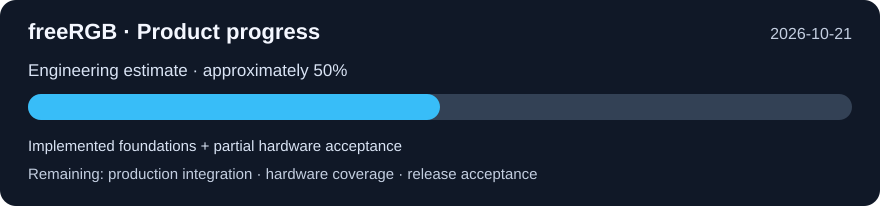

<div align="center">
<p align="center">
  
</p>
  
# FreeRGB

**Open, lightweight RGB control for Windows and Linux – written in Rust.**

An independent alternative to SignalRGB: a small background service drives your RGB
hardware directly, a native GUI and a local API control it. No cloud account, no telemetry,
no vendor software required.

[](https://github.com/leotrax3d/FreeRGB/actions/workflows/ci.yml)


[](https://github.com/leotrax3d/FreeRGB/releases)
[](https://github.com/leotrax3d/FreeRGB)

</div>

> [!WARNING]
> freeRGB is **early-stage software**. It talks to real hardware, including fan and pump
> controllers. Read [Safety](#safety) before you run it, and never run it at the same time
> as SignalRGB or iCUE.

---

## Project status

*Last updated: 2026-10-21. Includes current working-tree implementations; this is
not a claim that every change is already published in a release.*



**Overall progress: approximately 50% (engineering estimate).** This covers the
requested complete product, including motherboard cooling/RGB, installers, updates,
macros and hardware acceptance. It is not a test pass rate, a measured percentage
of supported hardware, or a promise of a delivery date. The tables below are the
authoritative feature inventory; individual tasks differ greatly in effort.

**Legend:** ✅ implemented · 🟡 partial / acceptance still required · ⬜ missing.
“Implemented” describes the named capability, not universal device support.
Synthetic tests, real hardware tests and public UI availability are distinguished.

### Implemented features and remaining work

| Area | Already implemented | Still missing / acceptance required |
|---|---|---|
| ✅ RGB engine | RGB/HSV, colour correction, LED layouts, shared canvas, frames, per-device brightness; isolated device workers, reconnect and hot-plug | Broader hardware coverage and multi-hour combined-device soak tests |
| ✅ Effects | 11 built-ins: Solid, Rainbow Wave, Breathing, Gradient, Colour Cycle, Radial Rainbow, Scanner, Twinkle, Audio Pulse, Audio Spectrum, Screen Ambience; custom layered effects | Further effects and richer layouts can be added; device coverage is separate |
| ✅ Effect editor | Up to eight layers, blending, opacity, regions, named effect library | Further UX refinement and broader interactive acceptance |
| ✅ Audio and screen lighting | Windows WASAPI loopback and primary-monitor capture; live RGB acceptance on existing Corsair hardware | Linux capture and real hardware acceptance |
| ✅ Daemon and local API | `freergbd`, bounded JSON-RPC IPC, diagnostics, persisted state/profiles, virtual-device mode; no cloud account | New live motherboard-control methods after safety acceptance; keep existing API additive |
| ✅ Profiles | Save/load profiles; Windows foreground-application rules with session opt-in and stability/debounce handling | Interactive application-switch acceptance and Linux integration |
| 🟡 Classic GUI | Device/effect controls, canvas layout, profiles, cooling definitions/channel annotations/custom sources, macros, monitoring, diagnostics, updates | Product polish and productive live motherboard cooling controls |
| 🟡 Modern GUI | Separate Tauri 2 + React implementation is being developed on `feature/tauri-gui`; shared daemon API is the compatibility boundary | Merge/release and feature parity; its current feature completion is tracked on that branch, not asserted here |
| 🟡 Device plugins | TOML descriptions, explicit trusted process plugins, bounded I/O, timeout/crash isolation, lifecycle API/UI and Rust virtual reference | More adapters, broader hot-load UX and effect-process plugins; plugins are not sandboxed |
| 🟡 Keyboard interaction | Daemon-owned per-key glow/fade overlay, K70 CORE key/LED mapping, optional Windows input helper, RPC editor and versioned configuration | Real typing-to-LED acceptance, more keyboards/layouts and Linux input |
| 🟡 Macros | Visual/JSON editor; save/run/cancel; delay/repeat, colours/effects/brightness, opt-in Windows text/key/media/chord output; session-opt-in global hotkeys | Recording, device-specific macro key assignment, real native output/hotkey acceptance and Linux native input |
| 🟡 Monitoring | Cached LINK RPM/temperatures, isolated motherboard sensor reader, histories with stale gaps, sensor alerts with debounce/hysteresis/acknowledgement, redacted diagnostic export | Verified CPU/GPU/coolant labels and sources across hardware; interactive acceptance |
| ✅ Custom temperature sources | Daemon-owned Celsius graphs: input, offset, min/max/average/sum/subtraction and time averaging; validation and freshness propagation | Bind trusted sources to productive live control; additional source providers |
| 🟡 Fan curves and calibration | Rust curve models/editor/storage/API, interpolation/hysteresis, temperature/stale-data policy; bounded calibration state machine and synthetic preview | Real reduced-duty calibration, verified minimum duty and productive hardware binding |
| 🟡 Channel assignment | Explicit header/control/RPM/fan-or-pump annotations, validation, persistence and Classic RPC editor | Physical/electrical confirmation across boards; annotations alone never authorize writes |
| 🟡 Motherboard discovery | Optional pinned LibreHardwareMonitor/PawnIO provider, protected Windows service, bounded authenticated local transport; actual ASUS/Nuvoton inventory read successfully | Additional chip/board acceptance, confirmed labels and alternative providers; detection does not imply writable support |
| 🟡 Native write evidence | Pinned Nct677X adapter captures original mode/command and checks actual command/mode registers; protected administrator diagnostic limited to 100% | Broader native backends and approved reduced-duty operation; shared-bit/EC variants and unsupported families remain blocked |
| 🟡 Crash recovery | Durable intent before writes; unresolved state blocks control/maintenance; protected original-state recovery with chip/process/service identity checks; real worker-crash test passed on the test board | Broader service/reboot/power-loss scenarios and multi-channel recovery; unresolved ownership must remain blocked |
| 🟡 Independent supervision | Rust lease and temperature/RPM/stall policies; private native lease/interlock; Rust runtime keeps sensor/timer checks running while native I/O waits | Productive trusted sampler/host wiring, full process-boundary fault acceptance and validated handling of driver hangs |
| 🟡 Protected curve execution | Rust runtime/owned host, authenticated service bridge and checked native sampler; actual constant100% curve with verified return passed on CHA_FAN2; six synthetic Rust/C# interoperability tests | Variable-duty hardware curves/calibration, normal daemon API/GUI callers and wider acceptance; see [bridge](docs/MAINBOARD_CONTROL_BRIDGE.md) |
| 🟡 Motherboard RGB/ARGB | Separate experimental ASUS USB backend (`0b05:19af`), manual ARGB lengths, protocol validation and mock tests; no PawnIO needed for this USB path | Actual header colour/fallback tests, setup UI, broader ASUS IDs and MSI/Gigabyte/ASRock/other protocols |
| 🟡 Windows installer | Inno Setup, project icon, launcher entry point, independent Start Menu/desktop/autostart choices (**autostart defaults on**), optional manufacturer uninstallers, configuration preservation; CI lifecycle tests | Interactive vendor-uninstaller acceptance, cross-version upgrade and remaining prerequisite/UAC/reboot scenarios |
| 🟡 Optional prerequisites | Explicit unchecked installer opt-in for verified LHM/PawnIO/missing .NET prerequisites and protected mainboard service; fixed hashes/publisher checks and failure/cancellation reporting | Wider clean-machine acceptance and alternate backends; these dependencies are not required for every RGB device |
| 🟡 Safe maintenance | Protected reservation mutex and pending/corrupt-journal refusal; owned Rust runtime host closes admission and drains with verified return; service stop waits for bounded diagnostics; synthetic/disposable-service tests | Connect the Rust host to production service/installer admission; active-control upgrade/uninstall/rollback acceptance |
| 🟡 Automatic updates | Fixed GitHub Release source, stable-version selection, bounded downloads, SHA-256 verification, staging/install UI, optional periodic checks/downloads | First published release, real version-to-version update and failure recovery, Authenticode signing; installation remains a visible user action |
| 🟡 GitHub and releases | Repository, Windows/Ubuntu CI, packaging/lifecycle workflows, installer artifacts and draft releases for version tags | Fresh acceptance for current changes, release publication, signing and release/branch protection policy |
| 🟡 Linux | Shared Rust core/IPC, CI builds/tests, udev rules and systemd user unit | Real hardware acceptance, capture/native input parity and distribution packages |

**Workspace:** 14 Rust crates. Hardware/business policy belongs in the daemon;
both GUIs use its local API. C# remains at the pinned Windows/LHM boundary and
Inno Setup handles Windows packaging. The project does not require SignalRGB,
iCUE or FanControl to control supported devices.

Detailed implementation history and test records:
[worklist](docs/WORKLIST.md), [testing](docs/TESTING.md),
[product plan](docs/PRODUCT_PLAN.md), [FanControl parity](docs/FANCONTROL_PARITY.md),
[mainboard cooling checklist](docs/COOLING_IMPLEMENTATION_PLAN.md),
[local API](docs/LOCAL_API.md), [macros](docs/MACROS.md),
[custom sensors](docs/CUSTOM_SENSORS.md), [keyboard interaction](docs/KEYBOARD_REACTIVE.md),
[mainboard RGB](docs/MAINBOARD_RGB.md).

### Actual motherboard hardware progress

On the **ASUS PRIME X870-P WIFI / Nuvoton NCT6701D** test system:

- [x] Install the protected service with explicit authorization; reuse the existing PawnIO driver.
- [x] Read actual sensor/control candidates; distinguish the Corsair AIO tachometer from the newly attached CHA_FAN2 fan.
- [x] Test only **100% duty** on the selected channel: observed approximately **1324 → 1709 RPM**, with native command-register verification.
- [x] Verify return to the original firmware mode and clear the recovery journal only after verification; later RPM returned to approximately 1300.
- [x] Kill the exact owned native worker during the 100% diagnostic; supervisor restart, protected baseline recovery and journal clearance succeeded.
- [x] Execute the Rust curve host through the real authenticated service and dedicated native worker, using checked native temperature/RPM sampling; constant100% curve and verified return passed.
- [ ] Accept reduced-duty response/calibration, sustained curves and temperature/RPM/stall fault handling on the productive path.
- [ ] Accept service/reboot failure cases and active-control upgrade/uninstall.
- [ ] Expose accepted live control through the daemon API and both GUIs.

These measurements establish progress on **one board and one fan channel**.
Normal GUI/API motherboard fan control remains disabled. They do not validate
every Nuvoton chip, another manufacturer's board, or motherboard RGB headers.
Support for all manufacturers is the goal; each backend still needs implementation
and validation. Fan power (PWM/DC) and lighting (5 V ARGB / 12 V RGB) are separate paths.

### Remaining delivery order

1. Extend the verified constant100% protected path to accepted variable-duty curves/calibration and normal daemon callers.
2. Complete independent fault supervision, recovery and safe active-session maintenance.
3. Perform reduced-duty, calibration, curve and failure acceptance on actual supported hardware.
4. Add documented live daemon methods and thin UI controls; coordinate modern-GUI parity through the shared API.
5. Expand motherboard fan/RGB backends and hardware coverage.
6. Finish macro recording/key assignment, sensor-source acceptance, installer/update/signing and Linux acceptance.

Process plugin demo (after a release build):
`freergbd --no-hardware --no-state --virtual-device --plugin examples/plugins/virtual-windows.json`.
Use the Linux manifest on Linux. Native plugins are explicitly trusted code, not sandboxed.

### Supported hardware

Only devices whose protocol has been verified on real hardware are ever written to.
Everything else is detected and listed, but never touched.

| Device | Status | Notes |
|---|---|---|
| Corsair **K70 CORE RGB** (`1b1c:1bfd`) | ✅ **Validated** | Per-key lighting (107 keys, ISO/ANSI), ~21 FPS, 20-min soak passed |
| Corsair **iCUE LINK System Hub** (`1b1c:0c3f`) | 🧪 **Experimental** (opt-in) | Lighting confirmed for RX/LX fans, Titan RX AIO pump head and LCD ring; ~50 FPS; fan/pump RPM watchdog |
| Corsair iCUE LINK child devices | ✅ detected | RX, LX, QX fans, Titan AIOs, LCD; Commander DUO recognised (no LEDs) |
| Corsair iCUE LINK AIO LCD screen (`1b1c:0c4e`) | 🔍 identified | Display content not supported |
| Corsair Vengeance RGB DDR5 (SMBus) | 🔍 identified | Deferred: SMBus writes near SPD are risky |
| ASUS AURA USB controller (`0b05:19af`) | 🧪 experimental backend | Explicit opt-in; RGB/ARGB header protocol implemented and mock-tested; real colour/fallback acceptance pending |
| ASUS PRIME X870-P WIFI / NCT6701D | 🧪 limited hardware acceptance | Actual sensor reads, selected CHA_FAN2 100% diagnostic, firmware return and worker-crash recovery passed; normal live fan control not enabled |
| Razer Cobra (`1532:00a3`) | 🔍 identified | |

Full details, test logs and confidence levels: [docs/DEVICES.md](docs/DEVICES.md) and
[docs/PROTOCOLS.md](docs/PROTOCOLS.md).

---

## Quick start

Requirements: Rust 1.80+ (stable). On Windows the MSVC toolchain; on Linux `libudev-dev`
and the usual X11/Wayland development packages for the GUI.

```bash
git clone https://github.com/leotrax3d/FreeRGB.git
cd FreeRGB
cargo build --release
```

Quit SignalRGB / iCUE first. Then:

```bash
# What is connected, and what would freeRGB drive? (read-only)
cargo run --release -p freergb-cli -- discover

# Start the background service (add --enable-link-hub for iCUE LINK fans/AIO)
cargo run --release -p freergb-daemon --bin freergbd

# Control it from a second terminal …
cargo run --release -p freergb-cli -- ctl color.set '{"color":"#00ffff"}'
cargo run --release -p freergb-cli -- ctl profiles.save '{"name":"Evening"}'

# … or with the GUI
cargo run --release -p freergb-gui
```

Explicitly stopping the daemon (`ctl daemon.shutdown` or Ctrl+C) requests return
of owned devices to hardware control. Closing the GUI leaves the daemon running.
Restoration failures must be reported and retained rather than treated as success.

Installing the binaries, Linux udev rules and a systemd user service: [docs/INSTALL.md](docs/INSTALL.md).

### Command-line tools

| Command | What it does |
|---|---|
| `freergb discover` | Lists HID devices and the adapter that would drive them (read-only) |
| `freergb bragi probe` | Reads firmware, mode and layout of a Corsair Bragi keyboard (read-only) |
| `freergb bragi color #ff0000` / `effect rainbow` / `key-walk` | Short hardware tests on the K70 CORE |
| `freergb link-probe [--software-window]` | iCUE LINK hub: firmware, child devices, fan RPM, temperatures |
| `freergb link-light-test` | Reversible colour test on the iCUE LINK chain with RPM watchdog |
| `freergb link-restore` | Puts the iCUE LINK hub back into hardware mode |
| `freergb validate-device <file.toml>` | Checks a device description without touching hardware |
| `freergb ctl <method> [json]` | Calls any [local API](docs/LOCAL_API.md) method on the running service |

---

## How it works

```
freergb-gui ─┐                                   ┌─ worker ─ K70 CORE
freergb-cli ─┼─ JSON-RPC (named pipe / socket) ─ freergbd ─ engine ─┼─ worker ─ iCUE LINK hub
other apps ──┘                                   └─ worker ─ …
```

* **Engine:** an effect renders onto a shared canvas; every device samples its region,
  gets brightness/colour correction applied, and receives the newest frame on its own
  worker thread. A slow device skips frames instead of slowing the others down.
* **Protocols** are pure, unit-tested packet encoders plus a small state machine per device,
  developed against simulators before they ever touch hardware.
* **Local API** only — no network port. Windows named pipe `\\.\pipe\freergb`, Linux socket
  `$XDG_RUNTIME_DIR/freergb.sock` (mode 0600).

| Crate | Purpose |
|---|---|
| `freergb-core` | Colours (RGB/HSV), colour correction, LED layouts, canvas, frames |
| `freergb-device-api` | Device and transport traits, virtual device, mock transport |
| `freergb-protocols` | Vendor adapters (Corsair Bragi, iCUE LINK), adapter registry |
| `freergb-hid` | HID discovery and transport (hidapi, native backends) |
| `freergb-effects` | Built-in effects |
| `freergb-daemon` | `freergbd`: engine, API, IPC, hardware scan, state and profiles |
| `freergb-client` | Blocking client for the local API |
| `freergb-cli` | `freergb` command-line tool |
| `freergb-gui` | Native GUI (egui/eframe) |

More in [docs/ARCHITECTURE.md](docs/ARCHITECTURE.md) and [docs/DECISIONS.md](docs/DECISIONS.md).

---

## Safety

freeRGB is written to fail safe:

* **Unknown devices are never written to.** Detection is read-only; only adapters marked
  *Experimental* or *Validated* are opened.
* **No firmware or flash writes.** Device property writes go through an allowlist (today
  only the hardware/software mode switch).
* **Cooling hardware is opt-in.** The iCUE LINK hub is only driven with `--enable-link-hub`.
  While freeRGB controls it, an RPM watchdog checks fans and pump every 2 s and returns the
  hub to hardware mode on any slowdown, then refuses to reconnect until restart.
* **Return is evidence-based.** Owned devices attempt their adapter-specific hardware
  fallback on shutdown. The experimental ASUS RGB fallback does not restore previous
  user settings. Mainboard cooling requires verified firmware-mode return before
  clearing its journal; unresolved recovery blocks further control and maintenance.
* **Other RGB software is detected.** While SignalRGB, iCUE or OpenRGB runs, `freergbd` hands
  all hardware back and leaves it alone (shown in the GUI); it resumes when they are closed.
  Concurrent access can lock up a device's vendor interface until it is re-plugged.

Details: [docs/SECURITY.md](docs/SECURITY.md).

---

## Roadmap

- [x] Platform-independent RGB core with tests
- [x] Virtual device and simulators
- [x] First real device (Corsair K70 CORE)
- [x] Background service with local API, state and profiles
- [x] iCUE LINK hub: fans, AIO, LCD ring (experimental)
- [x] Basic native GUI
- [ ] Longer hardware soak tests, then iCUE LINK out of experimental
- [x] Declarative device descriptions (first plugin stage)
- [x] Per-device placement on the effect canvas (layout editor in the GUI)
- [ ] More vendors: ASUS AURA, Razer, Logitech, …
- [x] Audio-reactive effects (pulse, spectrum)
- [x] Screen ambience
- [x] Effect editor (layers, blend modes, library)
- [x] Macro editor/execution and opt-in Windows global shortcuts
- [x] Monitoring histories, sensor alerts and daemon-owned custom temperature graphs
- [x] Reactive keyboard overlay and K70 key mapping (live typing acceptance pending)
- [x] Windows installer, launcher, shortcut/autostart choices and optional prerequisites
- [x] GitHub update checking, verified downloads and staging
- [x] Protected mainboard sensor service and limited real 100% fan/recovery diagnostic
- [ ] Production protected fan curves/calibration, independent fault acceptance and safe active-session maintenance
- [ ] Live motherboard fan API and both GUI integrations after acceptance
- [ ] Broad motherboard PWM/DC and RGB/ARGB coverage across manufacturers
- [ ] Macro recording, device-specific macro keys and native input acceptance
- [ ] Published signed release, real cross-version update/rollback and vendor-uninstaller acceptance
- [x] Linux udev rules and systemd user unit ([packaging/linux](packaging/linux))
- [ ] Hardware testing on Linux, packaging

Full roadmap: [docs/ROADMAP.md](docs/ROADMAP.md).

---

## How devices are added

New device support follows a fixed, reproducible process
([docs/REVERSE_ENGINEERING.md](docs/REVERSE_ENGINEERING.md)):

1. Identify the device (VID/PID, HID usage pages) – read-only.
2. Document the protocol with sources and a confidence level per field.
3. Implement it as a pure packet encoder and test it against a simulator.
4. Verify read-only on hardware (the device must report its own IDs back correctly).
5. Run reversible colour tests and confirm visually, then mark the device *Validated*.

No code from other RGB software is copied; only interface facts are used, with their
source documented.

---

## Contributing

Bug reports and device information are welcome, especially:

* `freergb discover --all` output for devices that are not supported yet,
* results of the read-only probes on other Corsair devices,
* testing on Linux.

Before opening a pull request, run:

```bash
cargo fmt --all -- --check
cargo clippy --workspace --all-targets -- -D warnings
cargo test --workspace
```

Current internal state and next steps: [docs/HANDOFF.md](docs/HANDOFF.md).

---

## Disclaimer

freeRGB is an independent project. It is not affiliated with, endorsed by or supported by
Corsair, WhirlwindFX (SignalRGB), ASUS, Razer or any other hardware vendor. All product
names are trademarks of their respective owners. Use at your own risk.

## License

Licensed under either of

* Apache License, Version 2.0 ([LICENSE-APACHE](LICENSE-APACHE))
* MIT license ([LICENSE-MIT](LICENSE-MIT))

at your option.

Unless you explicitly state otherwise, any contribution intentionally submitted for inclusion
in freeRGB by you, as defined in the Apache-2.0 license, shall be dual licensed as above,
without any additional terms or conditions.
